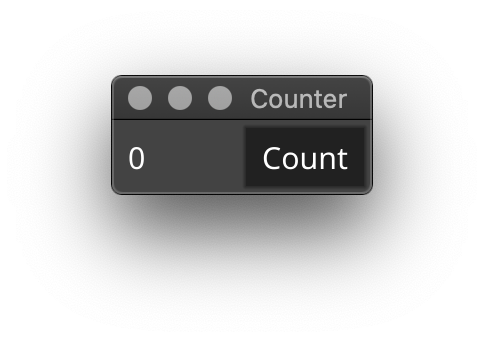
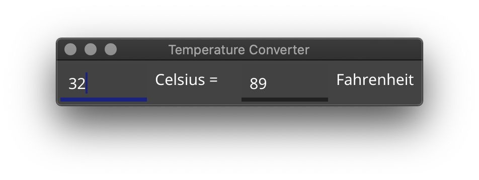
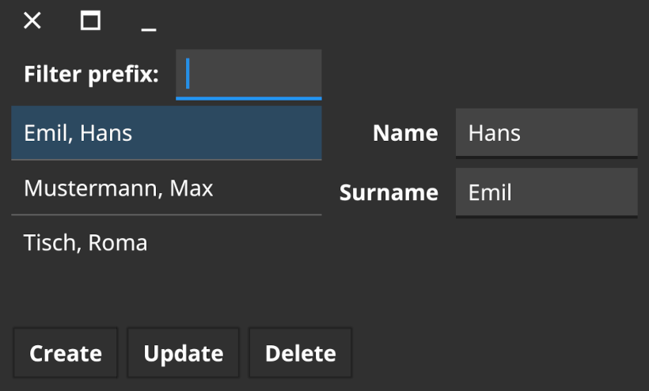

# granio-7guis

Компонент независимого проекта **Granio — Гранио**.

**Исходный репозиторий:** [7guis](https://github.com/fyne-io/7guis).
**Цель форка:** Семь базовых сценариев интерфейса на Granio.

История изменений, лицензии и сведения об исходных авторах сохранены.
Go-модули переведены на собственные пути `github.com/Uzer007-admin/…`;
минимальная версия Go — **1.27.1**. Ядро и общие API подключаются из
[`granio/v2`](https://github.com/Uzer007-admin/granio).

Состояние переноса и результаты проверок приведены в
[реестре экосистемы](https://github.com/Uzer007-admin/granio/blob/dev/granio/docs/ECOSYSTEM.md).
Наличие форка само по себе не означает проверку всех платформ и сценариев.

---

## Документация исходного проекта

Команды установки и ссылки в сохранённом тексте ниже относятся к исходнику.
Для Granio используются новые пути модулей, перечисленные выше.

# 7 GUIs using Fyne

An implementation of the [7 GUIs challenge](https://eugenkiss.github.io/7guis/)
using the [Fyne](https://fyne.io) toolkit.

## Counter

A simple counter that increments each time the "Count" button is pressed.

`go get github.com/fyne-io/7guis/counter`

## Temperature Converter

The temperature converter allows users to enter a value in degrees C or
degrees F and will automatically update the other field.

`go get github.com/fyne-io/7guis/temperature-converter`

## CRUD

Demonstration of how data is separated from rendering supporting create,
read, update and delete.

`go get github.com/fyne-io/7guis/crud`

