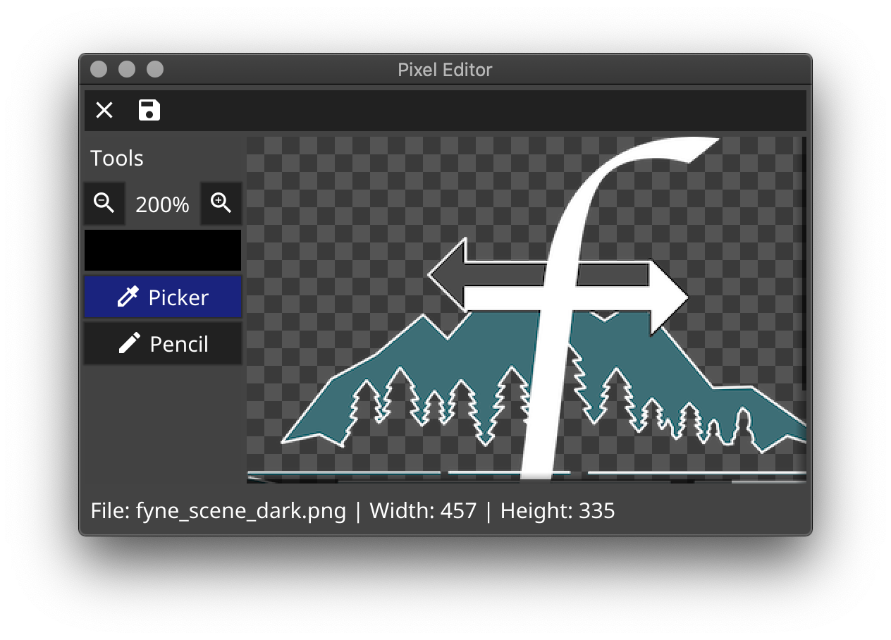

# granio-pixeledit

Компонент независимого проекта **Granio — Гранио**.

**Исходный репозиторий:** [pixeledit](https://github.com/fyne-io/pixeledit).
**Цель форка:** Редактор пиксельных изображений на Granio.

История изменений, лицензии и сведения об исходных авторах сохранены.
Go-модули переведены на собственные пути `github.com/Uzer007-admin/…`;
минимальная версия Go — **1.27.1**. Ядро и общие API подключаются из
[`granio/v2`](https://github.com/Uzer007-admin/granio).

Состояние переноса и результаты проверок приведены в
[реестре экосистемы](https://github.com/Uzer007-admin/granio/blob/dev/granio/docs/ECOSYSTEM.md).
Наличие форка само по себе не означает проверку всех платформ и сценариев.

---

## Документация исходного проекта

Команды установки и ссылки в сохранённом тексте ниже относятся к исходнику.
Для Granio используются новые пути модулей, перечисленные выше.

  
  
  
  

# Pixel Editor

A pixel based image editor built using Fyne.

